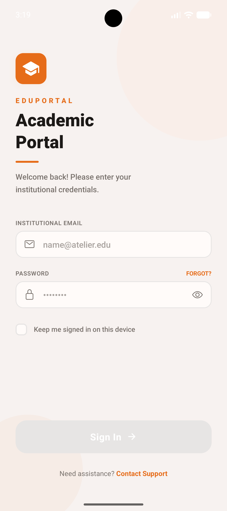
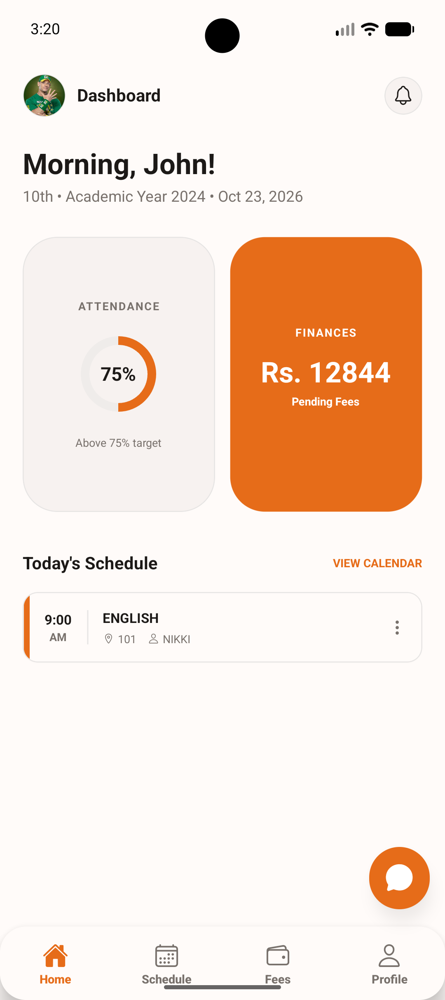
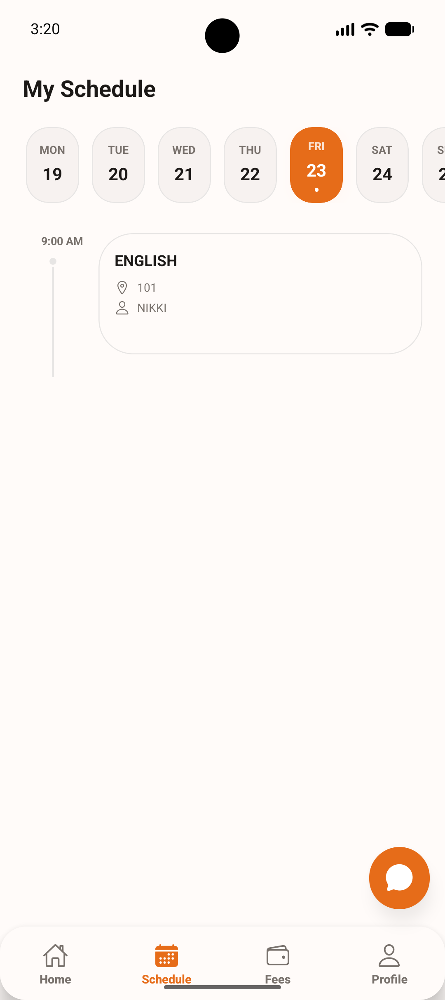
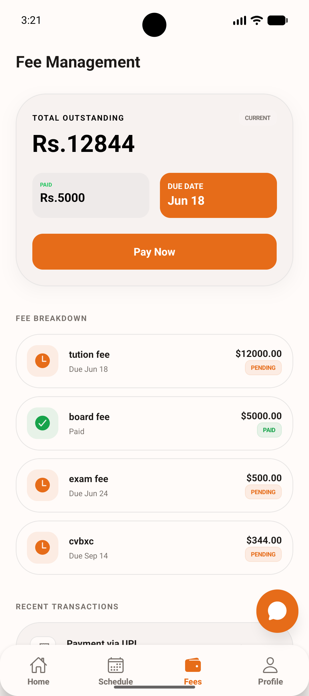
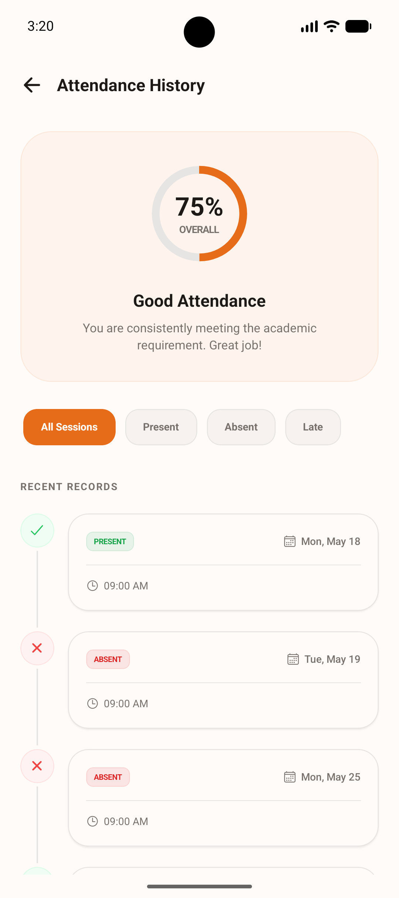
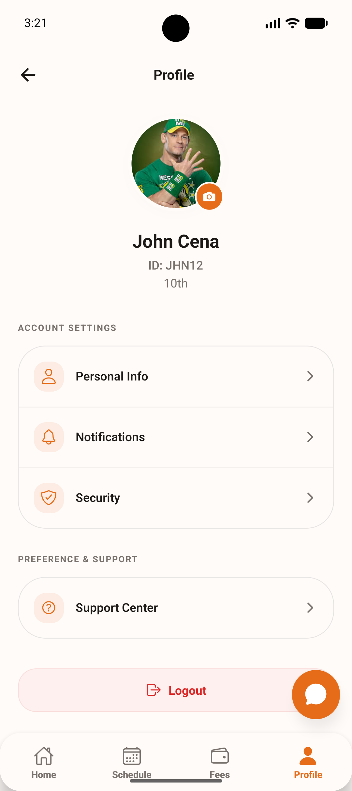
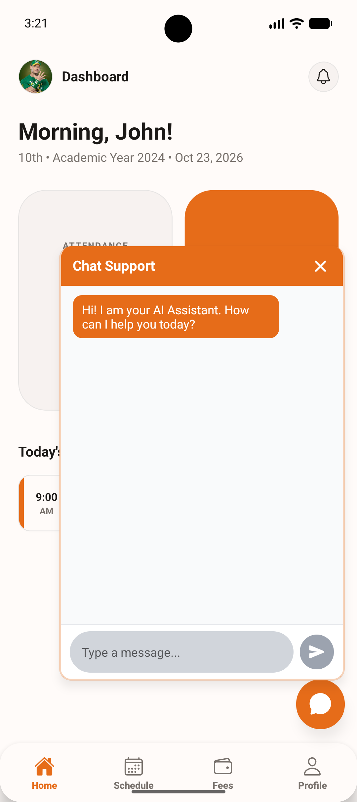
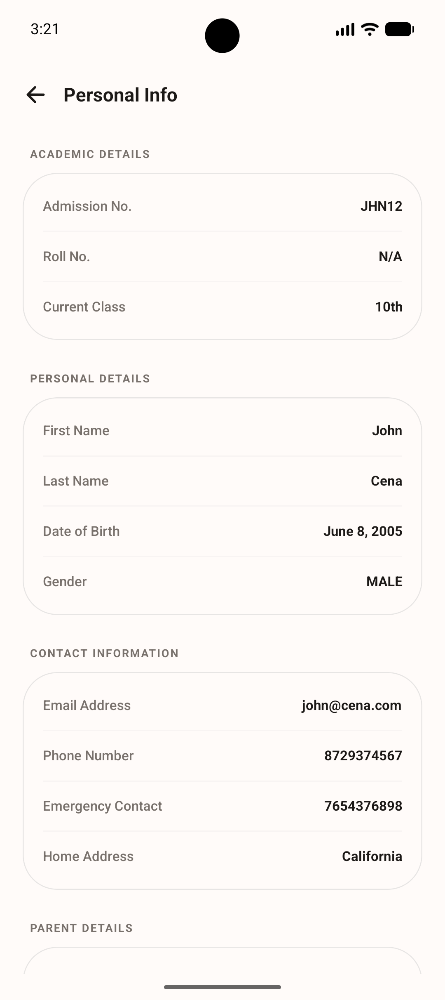

# EduPortal ERP

EduPortal is a mobile academic portal for students and teachers, built with Expo and React Native. It provides role-specific dashboards and access to schedules, attendance, fees, class information, profiles, and AI chat support.

## Features

### Student

- Sign in with institutional credentials.
- View a dashboard with attendance, outstanding fees, and today's schedule.
- Browse the weekly class schedule.
- Review and filter attendance history.
- View fee balances, due dates, and recent payment transactions.
- View profile information and sign out.

### Teacher

- View assigned classes and today's lectures.
- Browse the weekly lecture schedule.
- Open class details and manage class attendance.
- View teacher profile information and sign out.

### Shared

- Role-based navigation for student and teacher accounts.
- AI chat support with streamed responses.
- Persistent authentication state and cached API data.

## Screenshots

The screenshots below are stored in [`screenshots/`](./screenshots/).

| Login | Student dashboard | Schedule | Fees |
| --- | --- | --- | --- |
|  |  |  |  |

| Attendance | Profile | Chat support | Class details |
| --- | --- | --- | --- |
|  |  |  |  |

## Requirements

- Node.js (LTS recommended) and npm.
- A backend API available to the device or simulator.
- Android Studio and an Android emulator/device for Android development.
- Xcode and an iOS simulator/device for iOS development (macOS only).

## Getting started

1. Install dependencies:

   ```bash
   npm install
   ```

2. Configure the backend URL in [`src/services/apiClient.ts`](./src/services/apiClient.ts). The current default is `http://192.168.1.209:3000/api`; replace it with the base URL reachable from your development environment.

   - Android Emulator: use `http://10.0.2.2:3000/api` when the backend runs on your computer.
   - iOS Simulator: use `http://localhost:3000/api` when the backend runs on your computer.
   - Physical device: use your computer's LAN IP address and ensure the device and backend can reach each other.

3. Start the Expo development server:

   ```bash
   npm run start
   ```

4. Open the project on a target platform:

   ```bash
   npm run android
   npm run ios
   npm run web
   ```

The native platform commands use Expo prebuild/run workflows and may require the corresponding Android or iOS development tools to be installed.

## Backend API

The mobile client expects an API under the configured `/api` base path. The routes currently used by the app include:

| Purpose | API route |
| --- | --- |
| Sign in | `POST /auth/login` |
| Current user profile | `GET /users/me` |
| Student attendance | `GET /attendance/student/:userId` |
| Class schedule | `GET /schedule/class/:classId` |
| Student fees | `GET /fees/student-fees/student/:studentId` |
| Teacher's classes | `GET /teachers/classes` |
| Class details | `GET /classes/:classId` |
| Class attendance | `GET /attendance` |
| Submit attendance | `POST /attendance/bulk` |
| Teacher schedule | `GET /schedule/teacher/:teacherId` |
| AI chat stream | `GET /ai/stream?q=...` |

Authenticated requests use the access token returned by the login endpoint. The backend should provide the response fields consumed by the app, including the user role and the relevant student or teacher profile data. The backend itself is not included in this repository.

## Useful commands

| Command | Description |
| --- | --- |
| `npm run start` | Start the Expo development server |
| `npm run android` | Build and run the Android app |
| `npm run ios` | Build and run the iOS app |
| `npm run web` | Start the web version |
| `npm run lint` | Run Expo lint checks |

## Project structure

```text
src/
  app/          Expo Router routes for auth, student, and teacher flows
  components/   Shared UI, dashboard, auth, and chat components
  constants/    Theme, colors, and sample data
  hooks/        Login state and React Query data hooks
  services/     API client, authentication, and AI chat services
  store/        Persisted authentication state
  types/        Shared TypeScript types
screenshots/    App screenshots used in this README
```

## Tech stack

- Expo SDK 55, React Native 0.83, and TypeScript
- Expo Router for file-based navigation
- TanStack Query for API data fetching and caching
- Zustand and AsyncStorage for authentication state
- Axios for HTTP requests
- NativeWind and Tailwind CSS for styling
